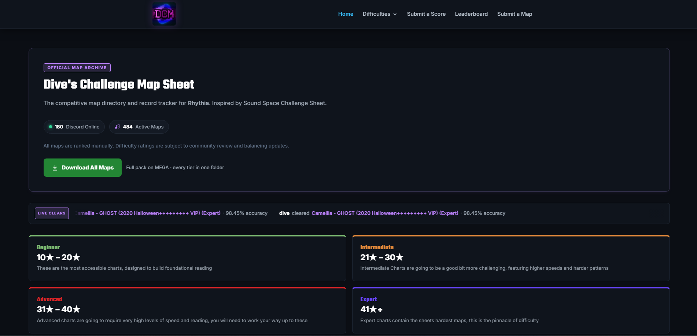
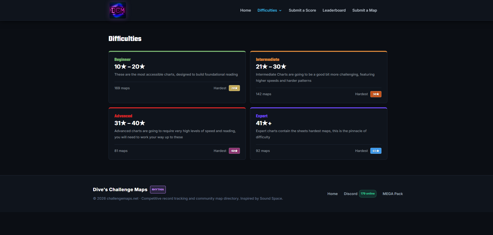
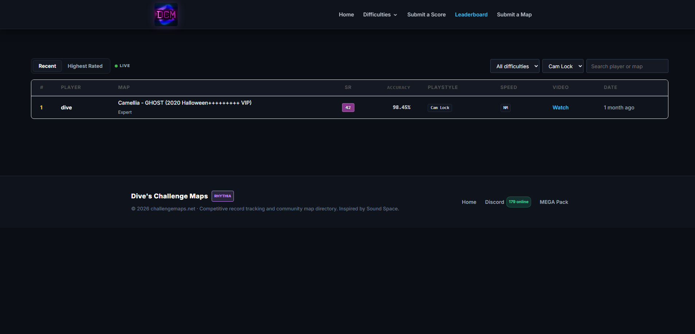
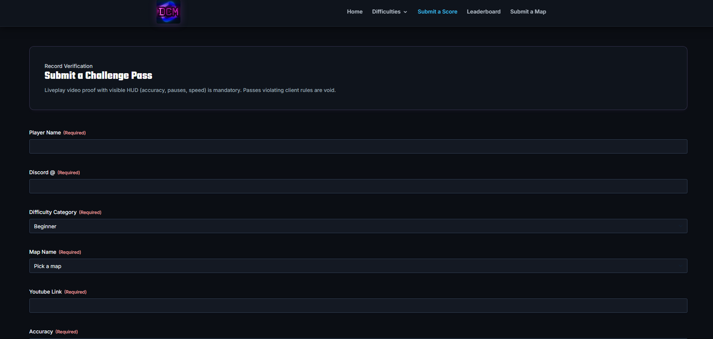
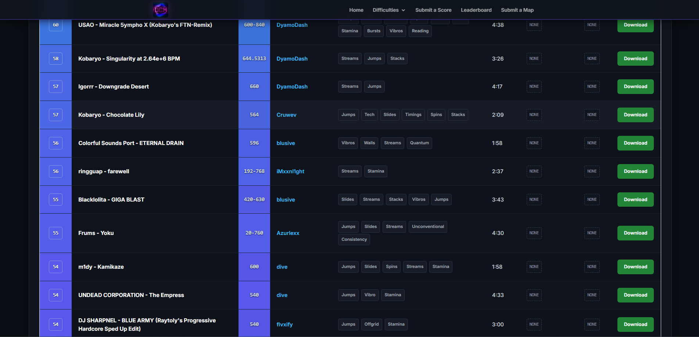

  

  
  

## **Objective**

Rhythia's community tracked its hardest challenge maps in a single spreadsheet. It held 484 maps across four difficulty tiers, each with song, BPM, mapper, star rating, patterns, length, download link, and best-pass scores. But a spreadsheet is hard to browse, can't accept submissions, and depends on one person to keep it updated.

I set out to turn that spreadsheet into a dedicated website where players could browse every tier, download maps, and submit scores for review.

## **Synopsis**

The site follows the model of speedrun.com and osu! beatmap listings: a browsable catalog paired with verified leaderboards. As on speedrun.com, every score is reviewed by a moderator before it counts.

The data structure came straight from how players already think about difficulty: Beginner (10–20 stars), Intermediate (21–30), Advanced (31–40), and Expert (41+). Each map tracks two separate best passes, one per control scheme (Cam Lock and Spin), since the community treats them as different skill paths.

## **Process**

1. **Data modeling.** I restructured the spreadsheet into one data file per tier: 169 Beginner, 142 Intermediate, 81 Advanced, and 92 Expert maps. I separated score values from speed-modifier tags like (S+), (NM), and (Ghost), since those are modifiers, not ranks.
2. **Browsing and downloads.** I built tier pages that list every map with its stats and a direct download link.
3. **Submission and review workflow.** Players can submit new maps or scores, and a small group of trusted reviewers approves them. Approved maps are added to the tier files, and approved scores automatically fill the Cam Lock or Spin best-pass column.
4. **Ranking logic.** I defined "best pass" by speed modifier first, then accuracy. That way, a pass with a harder modifier outranks a slightly more accurate pass with an easier one.
5. **Scope decisions.** I held off on automatic Discord posting to keep the first release focused on accurate data and moderation.

## **Results**

The site is live at [challengemaps.net](https://challengemaps.net) and has replaced the spreadsheet as the community's reference for all 484 challenge maps. Moderation is shared among trusted reviewers, so records no longer depend on one person. This was a self-directed project, built with requirements and feedback from Rhythia's staff team.

## **Code**

The site runs on a custom WordPress plugin I wrote, in the [`challengemaps`](challengemaps) folder (about 4,800 lines of PHP, JavaScript, and CSS).

| File | What it does |
|---|---|
| [`challengemaps.php`](challengemaps/challengemaps.php) | Plugin entry point: loads each feature module |
| [`inc/maps.php`](challengemaps/inc/maps.php) | Map data model and the four difficulty tiers |
| [`inc/score-form.php`](challengemaps/inc/score-form.php), [`inc/map-form.php`](challengemaps/inc/map-form.php) | Score and map submission forms |
| [`inc/review.php`](challengemaps/inc/review.php) | Moderator review queue for submissions |
| [`inc/speed.php`](challengemaps/inc/speed.php), [`inc/rankings.php`](challengemaps/inc/rankings.php) | Speed-modifier parsing and best-pass ranking |
| [`inc/leaderboard.php`](challengemaps/inc/leaderboard.php), [`inc/profiles.php`](challengemaps/inc/profiles.php) | Leaderboard and player profiles |
| [`inc/accounts.php`](challengemaps/inc/accounts.php), [`inc/security.php`](challengemaps/inc/security.php) | Discord sign-in and login rate limiting |
| [`js/`](challengemaps/js), [`css/`](challengemaps/css) | Front-end search, tabs, live clears ticker, and styles |

Secrets (the Discord app ID and secret) are read from the server environment and are not stored in this repository.

## **Project Photos**

*Home page: site overview, live clears feed, and the four difficulty tiers.*

*Difficulties page: each tier's star range, map count, and hardest map.*

*Leaderboard: recent verified passes, filterable by difficulty and control scheme.*

*Score submission form: players submit a pass with required video proof for review.*

*Expert tier: every map with its stats, pattern tags, and a download button.*

---

<a href="https://github.com/dclane5551">← Back to Danny Lane's profile</a>

